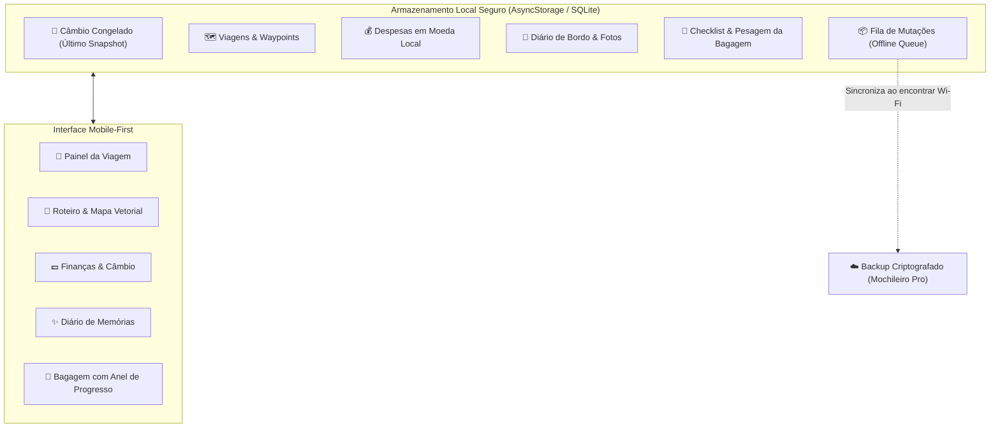

# 🧭 NomadLog — Diário de Bordo & Despesas Offline para Mochileiros e Nômades

> **Resumo Executivo:** O **NomadLog** é uma aplicação multiplataforma (iOS, Android e Web) construída com **React Native (0.88), Expo SDK 58, Expo Router, NativeWind v4 e TypeScript**, projetada com arquitetura **100% Offline-First**. Foi desenvolvido para quem viaja para destinos remotos, faz trilhas nas montanhas, enfrenta voos de longa duração ou quer economizar dados de roaming internacional, permitindo planejar roteiros, gerenciar bagagem com anel de progresso circular, registrar diário de memórias e controlar despesas em múltiplas moedas com conversão em tempo real sem depender de conexão à internet.

---

## 📌 Sumário

1. [Visão Geral e Problema de Negócio](#-1-visão-geral-e-problema-de-negócio)
2. [A Solução Offline-First](#-2-a-solução-offline-first)
3. [Modelo de Negócio e Monetização (Freemium & Mochileiro Pro)](#-3-modelo-de-negócio-e-monetização-freemium--mochileiro-pro)
4. [Catálogo de Módulos e Telas](#-4-catálogo-de-módulos-e-telas)
5. [Arquitetura de Dados e Fila de Sincronização](#-5-arquitetura-de-dados-e-fila-de-sincronização)
6. [Design System e Identidade Visual (Estilo `nutri-ai`)](#-6-design-system-e-identidade-visual-estilo-nutri-ai)
7. [Decisões Técnicas de Arquitetura (ADRs)](#-7-decisões-técnicas-de-arquitetura-adrs)
8. [Como Executar e Testar](#-8-como-executar-e-testar)

---

## 🎯 1. Visão Geral e Problema de Negócio

### O Problema do Mochileiro e Nômade Digital
Quem viaja pelo mundo ou explora lugares ermos enfrenta 4 grandes desafios:
- **Custo proibitivo de Roaming Internacional:** Pacotes de dados no exterior custam caro e muitas vezes o viajante desativa a rede celular para evitar surpresas na fatura.
- **Áreas sem sinal de telecomunicações:** Trilhas em parques nacionais, travessias de barco, trens noturnos e vilarejos remotos frequentemente têm cobertura celular zero.
- **Confusão de taxas em múltiplas moedas:** Ao negociar comida de rua, transporte local ou passeios (ex: Baht tailandês, Dong vietnamita, Peso argentino), é impossível consultar a cotação do dia na internet para saber quanto realmente se está gastando em Reais ou Dólares.
- **Dispersão de informações essenciais:** Roteiro salvo em PDF, gastos numa planilha que não abre offline, listas de bagagem esquecidas e memórias perdidas.

### A Proposta de Valor do `NomadLog`
O **NomadLog** centraliza toda a experiência do viajante com disponibilidade imediata garantida:
1. **Conversor de Moedas Offline:** As taxas de câmbio são congeladas localmente na última conexão. Ao digitar qualquer quantia em moeda local, o app calcula na hora o valor correspondente na moeda base da viagem (BRL ou USD).
2. **Mapa Vetorial e Altimetria Leve:** Em vez de mapas pesados que falham sem sinal (Google Maps/Mapbox), o app renderiza mapas vetoriais interativos em SVG com pontos de interesse (Waypoints), distâncias e perfis de elevação.
3. **Diário de Memórias com Tags de Trilha:** Registro com fotos locais, humor da viagem, tags climáticas e altitude em metros.
4. **Checklist Circular de Bagagem:** Inspirado nos melhores planners visuais, com anel de progresso circular e balança com peso total da mochila em quilogramas.

---

## 💡 2. A Solução Offline-First



---

## 💰 3. Modelo de Negócio e Monetização (Freemium & Mochileiro Pro)

| Recurso | Plano Gratuito (Base) | Mochileiro Pro |
| :--- | :---: | :---: |
| **Viagens Ativas Simultâneas** | 1 viagem por vez | **Ilimitadas simultâneas** |
| **Lançamentos de Despesas Offline** | Ilimitados | Ilimitados |
| **Conversor Multimoeda Offline** | Moedas da viagem atual | **Histórico e 150+ moedas** |
| **Checklist de Bagagem com Balança** | Completo | Completo |
| **Backup Criptografado em Nuvem** | Não | **Sim (Fila automática ao conectar)** |
| **Exportação de Relatórios (PDF/CSV)** | Não | **Sim (Relatórios para rateio)** |
| **Preço Sugerido** | R$ 0,00 | **R$ 59,90 vitalício** ou R$ 34,90/ano |

---

## 📱 4. Catálogo de Módulos e Telas

### 1. Painel Principal (`/`)
- **Card da Viagem Ativa:** Foto de capa, contagem de dias, badges de países e moedas em circulação.
- **Card de Orçamento Diário:** Gasto acumulado, teto da viagem, saldo restante e barra de progresso colorida com alerta de estouro.
- **Card de Bagagem com Anel Circular:** Visualização rápida do status da mochila e peso estimado.
- **Cronograma do Dia:** Próximas paradas e trilhas com botão de alternância de status.
- **Lançamento Rápido:** Modal flutuante para registrar compras em 2 toques com conversão imediata.

### 2. Roteiro & Mapa Vetorial (`/itinerary`)
- **Visualizador Vetorial SVG de Rotas:** Representação gráfica vetorial leve dos trechos da viagem (Bangkok ➡️ Ayutthaya ➡️ Chiang Mai ➡️ Doi Inthanon ➡️ Hanói) com altimetria topográfica.
- **Seletor de Dias Horizontal:** Navegue dia a dia (inspirado no Figma Daily Routine Planner).
- **Cards de Cronograma:** Detalhamento com hora, tipo de transporte/passeio (Voo, Ônibus, Trem, Trilha, Hostel, Ponto Turístico), distância em km e elevação.

### 3. Gastos & Conversor Multimoeda (`/expenses`)
- **Conversor de Câmbio em Tempo Real:** Seletor de moedas internacionais (BRL, USD, EUR, THB, VND, JPY, GBP, ARS, CLP, COP), input de cálculo rápido e botão de inverter moedas.
- **Distribuição de Gastos por Categoria:** Gráfico em barra colorida segmentada (Alimentação, Transporte, Hospedagem, Passeios, Equipamentos, Emergência).
- **Extrato Completo:** Lista de lançamentos com valor na moeda local e equivalente na moeda base da viagem.

### 4. Diário de Bordo & Memórias (`/journal`)
- **Feed Cronológico de Histórias:** Registros com data, hora e fotos em destaque.
- **Tags de Expedição:** Badges de humor (*Maravilhado*, *Aventureiro*, *Em Paz*, *Cansado & Feliz*, *Desafiado*), clima (*Ensolarado*, *Chuva*, *Neblina*, *Frio*) e altitude medida em metros.
- **Editor de Memórias:** Criação ágil com anotações e tags.

### 5. Checklist de Mochila & Bagagem (`/packing`)
- **Anel de Progresso Circular:** Indicador circular SVG com percentual de itens empacotados.
- **Balança Estimada:** Cálculo do peso total dos itens já guardados na mochila em kg.
- **Categorias Organizadas:** Documentos & Vistos, Equipamentos & Tech, Vestuário & Calçados, Saúde & Farmácia, Outros.

### 6. Painel de Controle Lateral (Desktop Web)
- Alternador de **Modo Sem Sinal (Simulador de Voo/Trilha)** vs. **Conexão Ativa**.
- Inspetor de **Fila de Mutações** com botão de sincronização simulada com a nuvem.
- Atualizador de **Snapshot de Cotações de Câmbio**.
- Seletor de **Plano Gratuito vs. Mochileiro Pro**.
- Botão de **Restauração de Dados de Demonstração**.

---

## 🎨 6. Design System e Identidade Visual (Estilo `nutri-ai`)

O visual adota o mesmo padrão de excelência de interface escura de alto contraste do projeto `nutri-ai`, adaptado para o universo nômade e outdoor:

| Token | Cor Hexadecimal | Uso Semântico |
| :--- | :--- | :--- |
| `primary[100]` | `#FF6838` | Laranja Aventura (Ações primárias, botões, destaques e status ativos) |
| `adventure.amber` | `#F59E0B` | Âmbar Moeda (Conversões de câmbio, valores monetários e cotações) |
| `adventure.emerald` | `#10B981` | Verde Trilha (Checklist concluído, saldo positivo e sucesso) |
| `adventure.sky` | `#38BDF8` | Azul Bússola (Altimetria em metros, coordenadas GPS e mapas vetoriais) |
| `adventure.purple` | `#A855F7` | Roxo Memória (Diário de bordo e hospedagens) |
| `grayscale[700]` | `#0F121A` | Dark Slate (Fundo principal do aplicativo) |
| `grayscale[600]` | `#161B26` | Superfície elevada dos cards de conteúdo |
| `grayscale[500]` | `#242B38` | Bordas e divisores de alto contraste |
| `grayscale[100]` | `#FFFFFF` | Títulos e números em destaque |

---

## 🛠️ 7. Decisões Técnicas de Arquitetura (ADRs)

### ADR 01: Arquitetura 100% Offline-First com Fila de Mutações
- **Decisão:** Todas as operações (criar gasto, marcar item de bagagem, salvar memória, alternar waypoint) gravam instantaneamente no estado local persistido via `AsyncStorage`, enfileirando uma entrada na `mutationQueue`.
- **Benefício:** Zero latência, 100% de disponibilidade mesmo em modo avião ou no meio de uma floresta, e sincronização segura com a nuvem quando houver sinal.

### ADR 02: Motor de Câmbio com Snapshot Congelado
- **Decisão:** A tabela de conversão entre moedas é salva localmente com timestamp do último acesso online, permitindo converter instantaneamente qualquer montante sem requisição HTTP externa.

### ADR 03: Mapa Vetorial Leve em SVG em vez de Tiles Online
- **Decisão:** Usar `react-native-svg` com curvas de Bézier e nós topográficos para renderizar o trajeto da viagem em vez de carregar pesados mapas rasterizados ou SDKs que falham sem rede.

### ADR 04: Estrutura Mobile-First com Moldura Responsiva para Web
- **Decisão:** Implementação de `DeviceFrame` (largura total nativa em smartphones; moldura de smartphone de 430px com painel lateral interativo em navegadores desktop).
- **Benefício:** Permite demonstração e testes imediatos no navegador com a sensação exata de um aplicativo real de celular.

---

## 🚀 8. Como Executar e Testar

### Pré-requisitos
- **Node.js** (v20+ ou v22 LTS)
- **NPM**

### Instalação e Execução

```bash
# 1. Acesse o diretório do projeto
cd nomad-log

# 2. Inicie a versão Web para testar no navegador com a moldura interativa
npm run web

# 3. Ou inicie o Expo para abrir no celular via Expo Go (iOS / Android)
npm start
```

### URLs de Teste Local
- **Aplicação Principal:** `http://localhost:8081`

