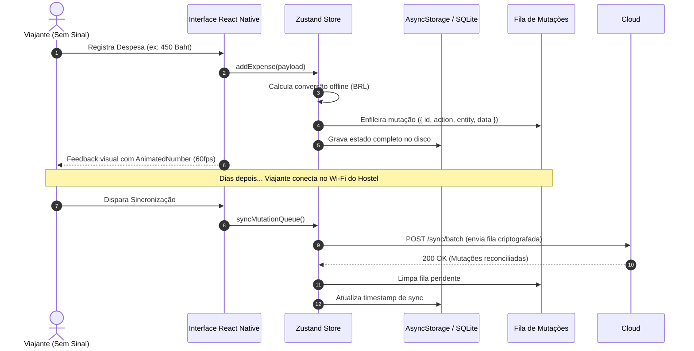

# 💾 Arquitetura Offline-First e Fila de Sincronização

> O **NomadLog** segue a premissa de que a rede é um aprimoramento passageiro, e não um pré-requisito de funcionamento. Todas as ações gravam primeiro no armazenamento local do dispositivo.

---

## 🏗️ Fluxo de Leitura e Escrita Local



---

## 📦 Estrutura da Fila de Mutações (`MutationItem`)

Cada alteração em modo offline gera um item de mutação padronizado:

```typescript
export interface MutationItem {
  id: string; // Ex: "mut_1730164800000_a8bc1"
  timestamp: number; // Timestamp Unix da criação
  action: "create" | "update" | "delete";
  entity: "expense" | "waypoint" | "journal" | "packing" | "trip";
  data: any; // Dados serializados para reconciliação
}
```

---

## 🛣️ Evolução Futura: Suporte a WatermelonDB / SQLite
Atualmente o app utiliza `AsyncStorage` com serialização rápida em JSON. A arquitetura foi desenhada de forma desacoplada para permitir fácil substituição por:
1. **`react-native-mmkv`:** Substituição drop-in que opera de forma síncrona com velocidade até 30x superior.
2. **`WatermelonDB`:** Para viagens gigantescas com mais de 10.000 fotos, trilhas GPS completas e waypoints densos.

---

## 🔗 Referências Cruzadas
- [[_project]] ➡️ MOC Geral.
- [[state-management-zustand-vs-context]] ➡️ Zustand Store com persistência.
- [[domain-multi-currency-and-fx]] ➡️ Motor de taxas de câmbio offline.

