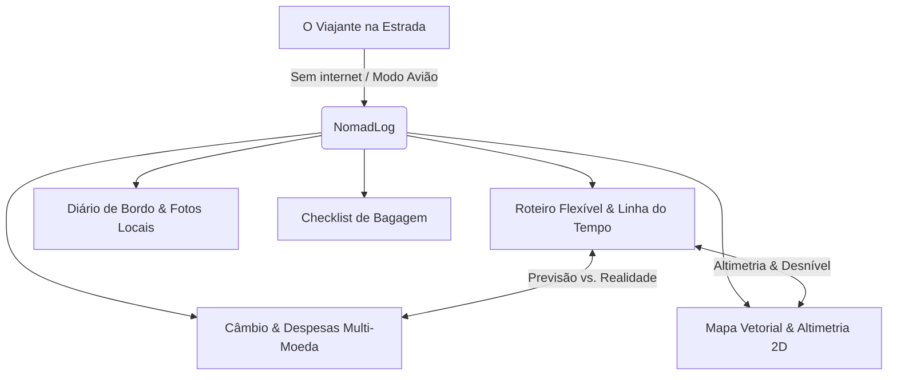

# 🧭 NomadLog: Matriz Comparativa e Proposta de Valor Única (USP)

> **Documento Estratégico de Referência de Produto**  
> *Versão:* 1.0.0  
> *Data:* Outubro de 2026  
> *Público-alvo:* Mochileiros, Nômades Digitais, Trilheiros e Viajantes Solo Independentes.

---

## 1. Visão Geral do Mercado e a "Grande Oportunidade"

O mercado de aplicativos de viagem está saturado de soluções que funcionam muito bem no conforto de uma casa com Wi-Fi de alta velocidade, mas que **falham no momento mais crítico**: quando o viajante está no meio de uma trilha sem sinal 4G/5G, em um trem noturno na Ásia ou economizando dados móveis em roaming internacional.

A maioria dos viajantes é forçada a alternar entre **3 a 4 aplicativos diferentes**:
1. Um para ver onde foi (**Polarsteps**);
2. Um para ver o roteiro turístico (**Wanderlog** ou **TripIt**);
3. Um para anotar gastos em moeda estrangeira (**TravelSpend** ou **Splitwise**);
4. E o bloco de notas ou WhatsApp para lembrar o que levar ou anotar pensamentos.

O **NomadLog** unifica essas pontas sob uma única filosofia inegociável: **Autonomia Total Offline-First**.



---

## 2. Matriz Comparativa Detalhada

| Funcionalidade / Pilar | **NomadLog** 🧭 *(Nosso App)* | **Polarsteps** 🌍 | **Wanderlog** 🗺️ | **TravelSpend** 💳 |
| :--- | :--- | :--- | :--- | :--- |
| **Arquitetura Offline** | **100% Nativo & Gratuito**. Todas as telas, mapas e cálculos rodam em banco local. | Salva coordenadas em cache, mas exige rede para carregar fotos e mapas detalhados. | **Cobrado no plano PRO (~$49/ano)**. Sem o plano pago, não funciona offline e depende do Google Maps. | Funciona offline para lançar despesas, mas não tem roteiro nem mapas. |
| **Roteiro & Cronograma** | **Linha do tempo dinâmica**: permite mover paradas entre dias com 1 toque e microajuste de horário (`-30m` / `+30m`). | ❌ **Não tem**. É apenas um rastreador passivo do passado, não um planejador do futuro. | ✅ Excelente no desktop com amigos, mas engessado e pesado no celular em trânsito. | ❌ Não tem planejamento de roteiro. |
| **Integração Roteiro ⇄ Gastos** | ✅ **Previsão vs. Realidade**: parada prevê custo e permite lançar despesa com 1 clique (pré-preenchida). | ❌ Inexistente. | ❌ Separado em abas distintas sem sincronia por parada. | ❌ Não vincula a paradas ou itinerário. |
| **Mapa & Topografia** | ✅ **Vetor 2D Leve + Altimetria**: perfil de relevo com picos e desnível acumulado (ideal para montanhas/trilhas). | Linha estilizada no globo 3D (bonita, mas sem dados topográficos e drena bateria). | Pinos tradicionais do Google Maps (pesados e dependentes de rede). | ❌ Não possui mapas. |
| **Motor de Câmbio Multi-Moeda** | ✅ **Snapshot em Cache Local**: converte entre 14+ moedas em 0ms sem precisar de cotação online. | ❌ Zero suporte a moedas ou finanças. | ⚠️ Converte moedas, mas exige internet para taxas atualizadas. | ✅ Bom conversor de moedas (foco exclusivo do app). |
| **Diário de Memórias** | ✅ **Fotos Reais do Aparelho**, humores, clima e altitudes gravadas localmente. | ✅ Excelente diário visual com foco em gerar livro impresso no final. | ⚠️ Anotações simples de texto em formato bloco de notas. | ❌ Não tem diário. |
| **Checklist de Bagagem** | ✅ **Integrado**: cálculo de peso total e status por categorias. | ❌ Inexistente. | ⚠️ Lista básica de texto sem métricas de peso. | ❌ Inexistente. |
| **Soberania dos Dados (Export)** | ✅ **Exportação Livre**: CSV para Excel, Backup JSON completo e Relatório formatado em Markdown. | ❌ Vende álbum físico impresso; difícil exportação estruturada. | ⚠️ Exporta para PDF / Sheets no plano Pro. | ⚠️ CSV bloqueado na versão gratuita. |

---

## 3. Análise dos Principais Concorrentes

### 3.1. Polarsteps
* **O que faz com maestria:**
  * Estética de "Travel Tracker": o trajeto desenhado no globo 3D é visualmente espetacular para mostrar a amigos e familiares.
  * Modelo de negócio físico consolidado: gera receita expressiva imprimindo "Travel Books" em capa dura enviados para a casa do viajante.
* **Onde falha gravemente:**
  1. **Zero Gestão Financeira:** Você não tem a menor ideia de quanto custou a viagem, quanto gastou em cada cidade ou se está estourando o orçamento diário.
  2. **Não é um Planejador:** Ele só registra *onde você já pisou*. Se você quiser planejar o que fazer amanhã às 14h em Chiang Mai, ele não serve.
  3. **Consumo de Bateria Elevado:** O rastreamento de GPS contínuo em segundo plano drena a bateria de aparelhos em trilhas longas.

---

### 3.2. Wanderlog
* **O que faz com maestria:**
  * Planejamento colaborativo no computador: é o líder de mercado para grupos de amigos montando viagens urbanas (ex: roteiro de 5 dias em Nova York ou Paris).
  * Importação de reservas: lê confirmações de voos e hotéis do Gmail.
* **Onde falha gravemente:**
  1. **Modo Offline Trancado por Paywall:** O viajante precisa assinar o plano Wanderlog Pro (~$49,99/ano) para conseguir abrir o roteiro sem internet.
  2. **Dependência Crônica do Google Maps:** Quando a internet cai, a experiência fica truncada com telas brancas e mapas travados.
  3. **Desconexão com Trilhas e Natureza:** Não fornece curvas de altimetria, ganho de elevação ou waypoints de trekking.
  4. **Interface Poluída:** O app tornou-se um agregador de anúncios de aluguel de carros, passeios afiliados e hotéis, tornando-o pesado em aparelhos intermediários.

---

### 3.3. TravelSpend / Trail Wallet
* **O que fazem com maestria:**
  * Controle financeiro simples e direto em moeda estrangeira.
* **Onde falham gravemente:**
  * São aplicativos de nicho único (apenas despesas). O viajante é obrigado a usar um segundo app para o roteiro, um terceiro para mapa e um quarto para fotos.

---

## 4. Os 4 Pilares do NomadLog (Nossa "Muralha Competitiva")

```
┌────────────────────────────────────────────────────────────────────────┐
│                        NOMADLOG CORE PILLARS                           │
├───────────────────┬───────────────────┬────────────────────────────────┤
│ 1. FLUIDEZ LOCAL  │ 2. ALTIMETRIA     │ 3. PONTE FINANCEIRA            │
│ Linha do tempo    │ Mapa vetorial 2D  │ Custo Previsto vs. Custo Real  │
│ reorganizável     │ com curva de      │ com conversão instantânea      │
│ sem travamentos.  │ relevo offline.   │ de 14 moedas em cache.         │
├───────────────────┴───────────────────┴────────────────────────────────┤
│ 4. RESILIÊNCIA E FILA SILENCIOSA                                       │
│ Mutações enfileiradas localmente; sincronia em segundo plano via Wi-Fi. │
└────────────────────────────────────────────────────────────────────────┘
```

### Pilar 1: Linha do Tempo Flexível & Baixa Fricção
Na estrada, o viajante muda de ideia a cada 2 horas por imprevistos climáticos, transporte ou novas amizades. No NomadLog:
- Mover uma atividade de hoje para daqui a dois dias leva **1 toque** (chips diretos de dias).
- Adiantar ou atrasar paradas por causa de uma van que quebrou leva **1 toque** nos botões `-30m` / `+30m`.

### Pilar 2: Altimetria e Mapa Vetorial 100% Offline
Em vez de tentar carregar tiles pesados do Google Maps, o NomadLog usa um canvas vetorial nativo super leve que roda a 60fps em qualquer aparelho:
- Traçado em curvas Bézier conectando os pontos da rota.
- Gráfico de perfil altimétrico: revela picos, vales e desnível acumulado (essencial para quem caminha ou faz passeios em montanhas).

### Pilar 3: O Elo Perdido (Roteiro ⇄ Despesas)
O maior diferencial de produto:
- O usuário cadastra uma parada no roteiro (*"Entrada no Parque Doi Inthanon"*) e prevê o custo em moeda local (*฿ 300*).
- O app exibe o botão **`+ Lançar Gasto`** direto no card da parada. Ao tocar, abre o modal de despesa **100% preenchido**.
- O topo do dia mostra um termômetro financeiro em tempo real:
  $$\text{Previsto: R\$ 250,00} \quad \text{vs} \quad \text{Gasto Real: R\$ 180,00}$$

### Pilar 4: Soberania Total e Resiliência
- O usuário não é feito refém: ele pode exportar suas despesas em **CSV compatível com Excel**, fazer um **Backup JSON completo** de toda a viagem ou gerar um **Relatório em Markdown** formatado para postar em blogs, Notion ou enviar para familiares no WhatsApp.

---

## 5. Posicionamento Estratégico de Marketing

### O Slogan Principal
> **"NomadLog — O Diário de Bordo e Painel de Despesas 100% Offline para Mochileiros e Nômades."**  
> *(EN: "NomadLog — The 100% Offline Field Logbook, Vector Route & Multi-Currency Tracker for Nomads.")*

### O Pitch de Elevador (30 Segundos)
> *"Aplicativos tradicionais como o Wanderlog exigem internet constante ou cobram caro para liberar um modo offline meia-boca. O Polarsteps registra onde você foi, mas não tem controle financeiro nem planejamento. O NomadLog une roteiro flexível, mapa vetorial com altimetria e motor de câmbio multi-moeda que funciona até no topo de uma montanha em Modo Avião. Você controla seus dias, seus gastos e suas memórias sem gastar um centavo de roaming."*

### Argumentos de Conversão para Campanhas (Reddit / Product Hunt / Redes)
1. **Contra o Wanderlog:** *"Cansado de pagar US$ 50/ano no Wanderlog Pro só para conseguir ver seu roteiro offline? No NomadLog, o offline é a primeira prioridade e é gratuito."*
2. **Contra o Polarsteps:** *"O Polarsteps é lindo para fotos, mas quanto você gastou na viagem? O NomadLog rastreia seu itinerário prevendo e convertendo seus custos em moeda estrangeira automaticamente."*
3. **Para Comunidades de Mochileiros (r/solotravel, r/digitalnomad):** *"Feito por quem viaja: mude paradas de dia com 1 toque, converta Baht, Dólar e Real em 0ms e exporte tudo em CSV no final."*

