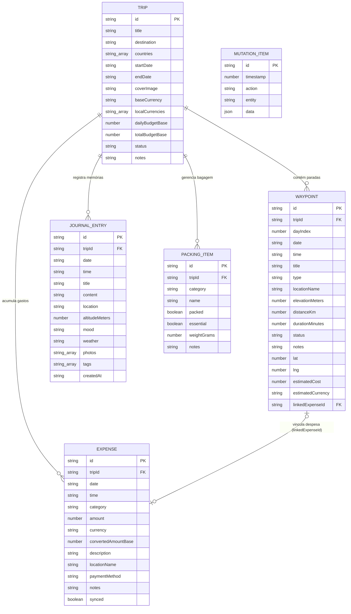

# 🗄️ Modelagem do Banco de Dados e Arquitetura de Dados

> O **NomadLog** adota uma modelagem **Document-Relational Offline-First** reativa, orquestrada via **Zustand** com persistência em disco via **AsyncStorage** e trilha de auditoria baseada em **Event Sourcing (Mutation Queue)**.

---

## 1. Diagrama Entidade-Relacionamento (ERD)



---

## 2. As 5 Entidades Principais

### 2.1. `Trip` (Raiz de Agregação / Aggregate Root)
Representa a viagem em si. Todas as outras entidades são filhas de uma `Trip` através da chave estrangeira `tripId`.

| Campo | Tipo | Descrição |
| :--- | :--- | :--- |
| `id` | `string` (PK) | Identificador único (`"trip_1"`, `"trip_1730..."`). |
| `title` | `string` | Nome da viagem (ex: *"Mochilão Sudeste Asiático"*). |
| `destination` | `string` | Destino principal ou resumo (ex: *"Tailândia & Vietnã"*). |
| `countries` | `string[]` | Lista de países visitados (ex: `["Tailândia", "Vietnã"]`). |
| `startDate` | `string` | Data de início em ISO `YYYY-MM-DD`. |
| `endDate` | `string` | Data de término em ISO `YYYY-MM-DD`. |
| `coverImage` | `string` | URL ou URI local da foto de capa. |
| `baseCurrency` | `CurrencyCode` | Moeda de referência do viajante (ex: `"BRL"` ou `"USD"`). |
| `localCurrencies` | `CurrencyCode[]` | Moedas locais em circulação (ex: `["THB", "VND"]`). |
| `dailyBudgetBase` | `number` | Teto orçamentário diário na moeda base. |
| `totalBudgetBase` | `number` | Teto orçamentário total estipulado para a viagem. |
| `status` | `enum` | `"active"` \| `"planned"` \| `"completed"`. |
| `notes` | `string?` | Observações gerais. |

---

### 2.2. `Waypoint` (Roteiro, Paradas & Linha do Tempo)
Representa cada parada, atividade, deslocamento ou hospedagem ao longo do itinerário da viagem.

| Campo | Tipo | Descrição |
| :--- | :--- | :--- |
| `id` | `string` (PK) | Identificador (`"wp_1"`, `"wp_1730..."`). |
| `tripId` | `string` (FK) | Chave estrangeira ligando à viagem. |
| `dayIndex` | `number` | Dia da viagem (1 para Dia 1, 2 para Dia 2, etc.). |
| `date` | `string` | Rótulo de exibição da data (ex: `"Dia 1"` ou `"2026-11-01"`). |
| `time` | `string` | Horário da atividade no formato `HH:MM` (ex: `"09:30"`). |
| `title` | `string` | Nome da atividade (ex: *"Trilha das Cachoeiras"*). |
| `type` | `WaypointType` | `"trek"` \| `"sight"` \| `"hostel"` \| `"bus"` \| `"train"` \| `"flight"` \| `"food"`. |
| `locationName` | `string` | Ponto de referência ou cidade. |
| `elevationMeters` | `number?` | Altitude em metros (usado no gráfico de Altimetria 2D). |
| `distanceKm` | `number?` | Distância do trecho em quilômetros. |
| `durationMinutes`| `number?` | Duração prevista em minutos. |
| `status` | `WaypointStatus`| `"pending"` \| `"in_progress"` \| `"done"`. |
| `estimatedCost` | `number?` | Custo estimado para a atividade. |
| `estimatedCurrency`| `CurrencyCode?`| Moeda da estimativa (ex: `"THB"`). |
| `linkedExpenseId`| `string?` (FK) | Vínculo 1:1 com a despesa real lançada no financeiro. |
| `lat` / `lng` | `number?` | Coordenadas geográficas GPS para bússola e mapa. |

---

### 2.3. `Expense` (Gestão Financeira & Despesas Multi-Moeda)
Registra cada transação financeira realizada em trânsito.

| Campo | Tipo | Descrição |
| :--- | :--- | :--- |
| `id` | `string` (PK) | Identificador da despesa (`"exp_1"`, `"exp_1730..."`). |
| `tripId` | `string` (FK) | Viagem associada. |
| `date` | `string` | Data do gasto `YYYY-MM-DD`. |
| `time` | `string` | Hora do gasto `HH:MM`. |
| `category` | `ExpenseCategory`| `"food"` \| `"transport"` \| `"stay"` \| `"activity"` \| `"gear"` \| `"emergency"` \| `"other"`. |
| `amount` | `number` | Valor numérico na moeda original paga. |
| `currency` | `CurrencyCode` | Moeda em que o gasto foi pago (ex: `"THB"`, `"USD"`). |
| `convertedAmountBase`| `number` | **Valor instantâneo convertido** para a moeda base (ex: BRL). |
| `description` | `string` | Descrição do item (ex: *"Aluguel Scooter 125cc"*). |
| `locationName` | `string` | Localização do estabelecimento. |
| `paymentMethod` | `PaymentMethod` | `"cash"` \| `"card"` \| `"wise"` \| `"crypto"`. |
| `notes` | `string?` | Detalhes adicionais. |
| `synced` | `boolean` | Flag de sincronização com nuvem. |

---

### 2.4. `JournalEntry` (Diário de Bordo & Memórias)
Captura narrativas, impressões emocionais, clima e registros fotográficos locais.

| Campo | Tipo | Descrição |
| :--- | :--- | :--- |
| `id` | `string` (PK) | Identificador (`"jn_1"`, `"jn_1730..."`). |
| `tripId` | `string` (FK) | Viagem associada. |
| `date` / `time` | `string` | Momento do registro `YYYY-MM-DD` / `HH:MM`. |
| `title` | `string` | Título da memória. |
| `content` | `string` | Texto completo do relato da experiência. |
| `location` | `string` | Local do relato. |
| `altitudeMeters` | `number?` | Altitude registrada no momento do relato. |
| `mood` | `JournalMood` | `"amazed"` \| `"tired_happy"` \| `"adventurous"` \| `"peaceful"` \| `"challenged"`. |
| `weather` | `WeatherTag` | `"sunny"` \| `"rainy"` \| `"foggy"` \| `"cold"` \| `"stormy"`. |
| `photos` | `string[]` | Array de caminhos locais (`file://...`) ou URLs de imagens. |
| `tags` | `string[]` | Tags temáticas (ex: `["#trilha", "#mochilao"]`). |
| `createdAt` | `string` | Timestamp ISO da criação. |

---

### 2.5. `PackingItem` (Checklist de Bagagem / Mochila)
Controla o inventário físico do mochileiro para evitar perdas ou excesso de peso.

| Campo | Tipo | Descrição |
| :--- | :--- | :--- |
| `id` | `string` (PK) | Identificador (`"pack_1"`). |
| `tripId` | `string` (FK) | Viagem associada. |
| `category` | `PackingCategory`| `"documentos"` \| `"equipamentos"` \| `"roupas"` \| `"farmacia"` \| `"outros"`. |
| `name` | `string` | Nome do item (ex: *"Passaporte e Cópias"*). |
| `packed` | `boolean` | `true` se já está na mochila, `false` se pendente. |
| `essential` | `boolean` | Item crítico (não pode ser esquecido). |
| `weightGrams` | `number?` | Peso estimado em gramas para controle de sobrepeso. |

---

## 3. Entidades de Suporte e Infraestrutura

### 3.1. `MutationItem` (Fila de Mutações Offline / Event Sourcing)
Garante que qualquer alteração realizada sem conexão seja gravada como um evento imutável para reconciliação na nuvem:

```typescript
export interface MutationItem {
  id: string; // Ex: "mut_1730289000000_3x8"
  timestamp: number; // Unix Epoch em milissegundos
  action: "create" | "update" | "delete";
  entity: "expense" | "waypoint" | "journal" | "packing" | "trip";
  data: any; // Cópia exata do payload gravado
}
```

### 3.2. `UserSubscription` (Modelo Freemium)
```typescript
export interface UserSubscription {
  plan: "free" | "pro";
  activeUntil?: string;
  unlimitedTrips: boolean; // Free = 1 viagem ativa; Pro = ilimitadas
  encryptedCloudBackup: boolean;
  offlineFxHistory: boolean;
  exportReports: boolean;
}
```

### 3.3. Snapshot de Câmbio em Cache (`rates`)
Dicionário indexado pelas 15 moedas suportadas com a taxa em relação ao Dólar Americano (`USD`):
```typescript
rates: Record<CurrencyCode, number>; // { BRL: 5.85, THB: 34.50, EUR: 0.92, ... }
ratesSnapshotTimestamp: number;     // Momento da última sincronização das taxas
```

---

## 4. Persistência em Disco e Ciclo de Vida

1. **Storage Engine**: `@react-native-async-storage/async-storage`.
2. **Chave no Disco**: `@nomadlog/state/v1`.
3. **Escrita Reativa**: Sempre que uma ação do Zustand é executada (`addExpense`, `moveWaypointToDay`, etc.), o estado é atualizado na memória em **0ms** e disparada a serialização assíncrona para o disco.
4. **Hidratação Inicial**: Na inicialização do app, a função `hydrate()` lê a chave `@nomadlog/state/v1`. Caso não haja dados salvos, carrega o estado semente (`seed.ts`) com a viagem de exemplo pelo Sudeste Asiático.
5. **Transição Futura (SQLite / WatermelonDB)**: A separação clara das entidades através de chaves primárias `id` e chaves estrangeiras `tripId` e `linkedExpenseId` permite migrar o storage para **SQLite nativo (expo-sqlite)** ou **WatermelonDB** sem alterar os componentes de tela.

