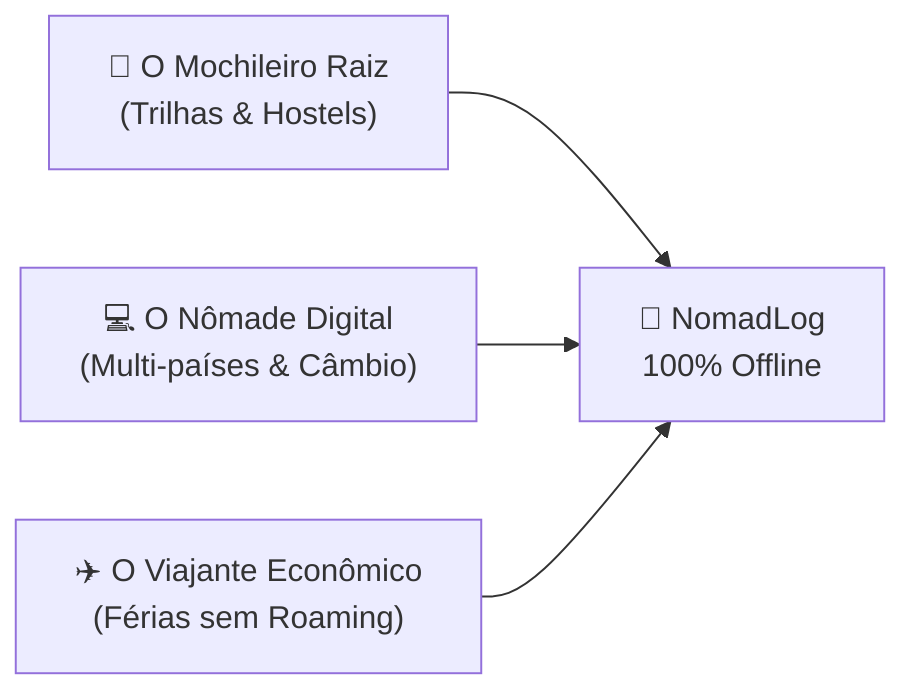
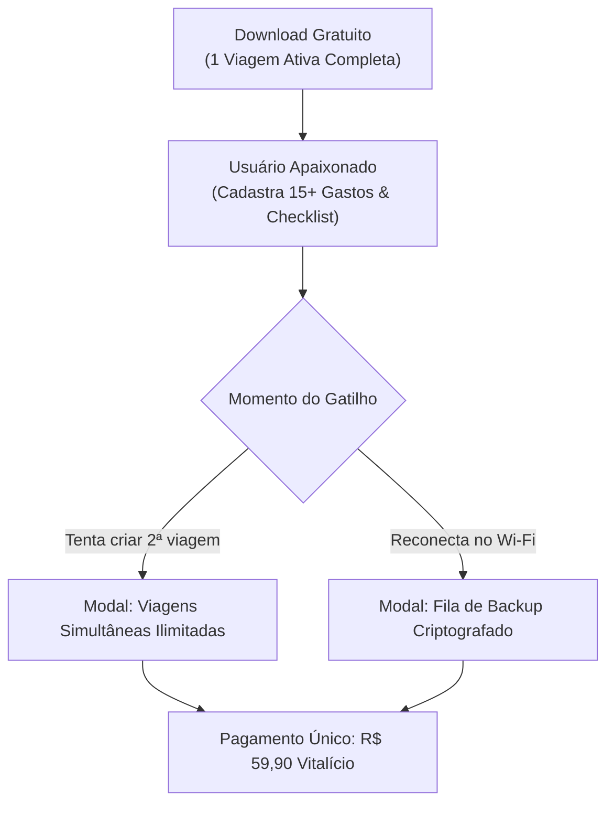

# 🚀 Estratégia de Marketing e Go-To-Market — NomadLog

> **Proposta Única de Valor (USP):** *"O copiloto de viagem 100% offline. Controle de despesas multimoedas, roteiro dia a dia e diário de memórias no topo de montanhas, trens noturnos e fronteiras remotas sem gastar 1 KB de roaming."*

---

## 🎯 1. As 3 Personas de Alta Conversão

| Persona | Dores Críticas | Mensagem Central de Venda |
| :--- | :--- | :--- |
| **O Mochileiro Raiz / Trekker** | Trilhas de vários dias sem cobertura celular; medo de levar peso excessivo na mochila; perda de memórias. | *"Acompanhe sua rota com altimetria em SVG e saiba o peso exato da sua mochila na balança sem depender de sinal."* |
| **O Nômade Digital Internacional** | Muda de país a cada poucas semanas; confuso com 4 moedas diferentes (THB, VND, IDR, EUR); planilhas travam offline. | *"Converta instantaneamente o preço do almoço ou da scooter na moeda local para Reais com taxa congelada."* |
| **O Viajante Econômico** | Pânico de faturas astronômicas de dados no exterior; viaja com celular em modo avião. | *"Mantenha seu celular em modo avião a viagem inteira sem perder nenhum gasto ou compromisso do roteiro."* |

---

## 📱 2. Roteiros de Conteúdo Viral para TikTok & Instagram Reels (Formatos POV)

O público viajante é altamente engajado com vídeos curtos em formato **POV (Point of View)** com estética documental e cortes rápidos:

### Roteiro 1: "O Choque da Cotação na Feira de Rua"
- **Gancho (0-3s):** Mostre uma comida exótica ou feira de rua na Ásia ou América Latina: *"Quando o garçom me cobrou 180.000 Dong no Vietnã e eu não tinha internet..."*
- **Desenvolvimento (3-12s):** Tela do NomadLog abrindo instantaneamente em modo avião, digitando `180000 VND` e mostrando na hora: `≈ R$ 41,50`.
- **Chamada de Ação (12-18s):** *"Pare de passar perrengue ou pagar roaming caro no exterior. O NomadLog funciona 100% offline. Link na bio."*

### Roteiro 2: "Como Viajar sem Chip Internacional"
- **Gancho (0-3s):** Imagem do aeroporto ou balcão de eSIM cobrando $ 45 dólares por 5 GB de internet: *"Como eu economizo R$ 300 em toda viagem internacional desativando o roaming."*
- **Desenvolvimento (3-15s):** Mostre o NomadLog com a rota diária salva, mapa vetorial com altimetria, checklist da bagagem de mão com peso e o conversor offline.
- **CTA (15-20s):** *"Disponível grátis para iOS e Android."*

---

## 🌐 3. Canais de Aquisição Orgânica (Zero Reais de Investimento)

### A. Comunidades e Fóruns de Mochileiros
- **Mochileiros.com:** Criar tópicos com relatos de viagem reais (ex: *"Mochilão de 20 dias no Sudeste Asiático: Planilha vs App Offline"*). Compartilhar a ferramenta de forma genuína.
- **Grupos do Facebook:** "Brasileiros na Tailândia", "Brasileiros no Sudeste Asiático", "Nômades Digitais Brasil", "Mochileiros América do Sul".
- **Reddit:**
  - `r/solotravel`: Post com o título *"Built an offline-first travel expense & itinerary log for remote treks and roaming-free travel"*.
  - `r/digitalnomad`: Focar na conversão multimoedas simultânea.

### B. Micro-Parcerias com Criadores de Conteúdo Nômades
- Identificar criadores no Instagram/TikTok com entre **5k e 50k seguidores** que estejam ativamente viajando.
- **Abordagem sem custo fixo:** Oferecer a assinatura **Mochileiro Pro Vitalícia Gratuita** em troca de um story honesto mostrando o app sendo usado na rua.

---

## 🔄 4. Mecanismos de Viralidade Product-Led (PLG)

1. **Card de Memória Exportável para Stories:**
   - No Diário de Bordo, um botão *"Compartilhar Momento"* gera um card 9:16 com a foto, altitude, humor e uma logo discreta: *"Registrado offline no NomadLog"*.
2. **Exportação de Roteiro em PDF/CSV para Companheiros de Viagem:**
   - Ao viajar em dupla ou grupo, o usuário exporta os gastos para rateio no grupo de WhatsApp, expondo o aplicativo para novos usuários potenciais.

---

## 📈 5. Funil de Conversão para o "Mochileiro Pro"

- **Por que a taxa de conversão é alta:** O modelo vitalício (*Lifetime*) gera pouca resistência de compra comparado a planos de assinatura recorrente mensal. R$ 59,90 custa menos que um único dia de roaming internacional de operadora tradicional.

---

## 🗓️ 6. Cronograma de Lançamento (30 Dias)

| Período | Ação Chave | Meta |
| :--- | :--- | :--- |
| **Dias 1 a 7** | Landing Page no ar + Teste Beta com 20 mochileiros em viagem ativa. | Colher feedbacks e prints reais de uso. |
| **Dias 8 a 15** | Post de Lançamento no Reddit (`r/solotravel`) e no Mochileiros.com. | 250 primeiros downloads orgânicos. |
| **Dias 16 a 22** | Publicação dos 4 primeiros vídeos de formato POV no TikTok e Reels. | Alcance de 15.000 visualizações orgânicas. |
| **Dias 23 a 30** | Lançamento no Product Hunt + Oferta de Lançamento do Plano Pro Vitalício. | Primeiras 50 conversões pagas. |

---

## 🔗 Referências Cruzadas
- [[_project]] ➡️ MOC do Projeto.
- [[monetization-and-freemium]] ➡️ Preços e divisões do Pro.
- [[domain-multi-currency-and-fx]] ➡️ Motor de taxas offline.

