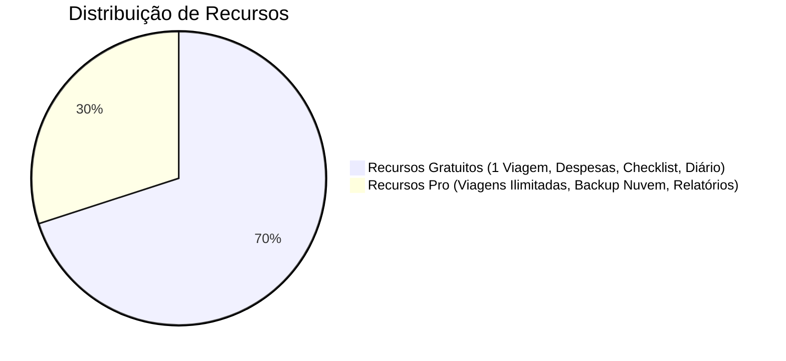

# 👑 Modelo de Negócio: Freemium & Pacote Mochileiro Pro

> A estratégia de monetização equilibra alta generosidade no plano base (essencial para que o viajante confie e utilize no meio de uma viagem) com diferenciais indispensáveis para usuários frequentes.

---

## 💎 Divisão de Planos e Cotas

### 1. Plano Gratuito (O Mochileiro Base)
- **1 Viagem Ativa por vez:** O usuário planeja e executa sua viagem atual com todos os recursos offline.
- **Despesas Ilimitadas:** Sem bloqueio no número de despesas lançadas.
- **Checklist Completo:** Todas as categorias de bagagem com contagem de peso.
- **Diário de Memórias Local:** Registro completo sem limites de caracteres.

### 2. Pacote Mochileiro Pro
- **Viagens Simultâneas Ilimitadas:** Planeje o mochilão do ano que vem enquanto registra a viagem atual.
- **Backup Criptografado Ponta a Ponta:** Cópia de segurança na nuvem com chave simétrica AES-256 no dispositivo quando houver sinal.
- **Exportação de Relatórios em PDF e CSV:** Geração de planilha pronta para dividir custos com companheiros de viagem ou prestação de contas corporativa/nômade.
- **Histórico Completo de Câmbio:** Cotações históricas dos últimos 180 dias.

---

## 🏷️ Estratégia de Preço e In-App Purchases

| Modalidade | Preço Sugerido (BRL) | Preço Internacional (USD) | Posicionamento |
| :--- | :---: | :---: | :--- |
| **Acesso Vitalício (Lifetime)** | **R$ 59,90** (pagamento único) | **$ 14.99** | *Recomendado / Melhor Valor.* O viajante paga uma vez e leva o app para todas as viagens da vida. |
| **Assinatura Anual** | **R$ 34,90** / ano | **$ 8.99** / ano | Para quem quer experimentar em uma temporada específica de férias. |

---

## 🔗 Referências Cruzadas
- [[_project]] ➡️ MOC do Projeto.
- [[architecture-and-offline-sync]] ➡️ Como o backup na nuvem processa a fila de mutações.
- [[domain-multi-currency-and-fx]] ➡️ Histórico de taxas no plano Pro.

